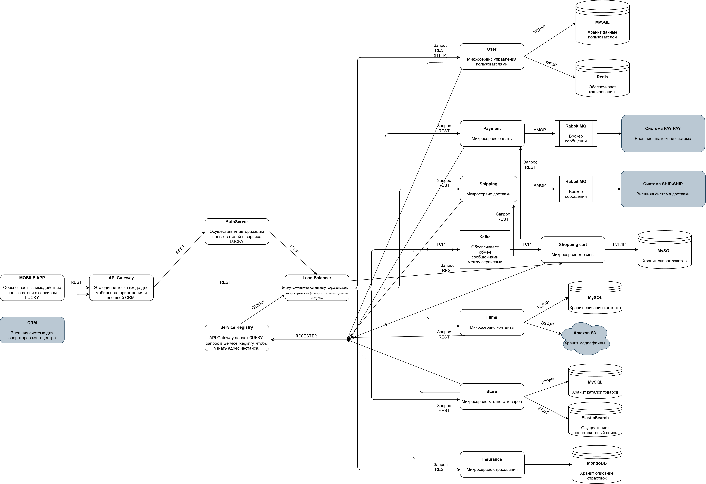

# 🐾 Проектирование микросервисной архитектуры (C4) и REST API (OpenAPI 3.0) для сервиса страхования животных LUCKY

## О проекте

**Заказчик / продукт** — **LUCKY**, экосистема для владельцев домашних животных (мобильное приложение для заказа зоотоваров, просмотра тематического контента и оформления услуг) на базе микросервисной архитектуры (7 микросервисов и 4 внешние системы).

**Бизнес-задача** — расширение продуктовой линейки за счёт запуска нового раздела **«Страхование домашних питомцев»** (на этапе MVP — для кошек и собак, с прогнозом ~5 000 просмотров и ~100 оформлений в сутки, SLA времени ответа ≤ 10 секунд и поддержкой англоязычной локализации).

**Цель проекта** — проанализировать текущую микросервисную архитектуру и пользовательский путь по макетам, спроектировать интеграцию нового сервиса в модель контейнеров **C4** и разработать спецификацию **REST API** в формате **OpenAPI 3.0 (YAML)** для передачи в разработку.

**Артефакты в репозитории:**
- диаграмма контейнеров в нотации **C4** (`c4-containers.drawio.png`);
- спецификация контракта **REST API** в формате **OpenAPI 3.0 / Swagger** (`Спецификация OpenAPI (Swagger) _ Интеграционный метод.yaml`).

## Заметки на полях

**Ключевые архитектурные решения (Модель C4)**

1. **Выделенный микросервис `Insurance` + `MongoDB` (Database per service):** вместо добавления страховых полисов в общий каталог товаров `Store` спроектирован самостоятельный микросервис `Insurance` с документоориентированной БД **MongoDB**. Гибкая схема хранения позволяет в будущем масштабировать продукт на другие виды питомцев и сложные тарифы без миграций реляционных таблиц.
2. **Переиспользование контура корзины и оплаты:** на этапе MVP оформление страховки встроено в существующий процесс покупки — клиент добавляет полис в корзину (`Shopping cart` через **Kafka**), оплачивает через `Payment` (**RabbitMQ** → внешняя система `PAY-PAY`), а данные о заказе передаются операторам колл-центра во внешнюю `CRM` через `API Gateway` для последующего оформления документов. Служба доставки (`Shipping`) при этом не задействуется.
3. **Инфраструктурные паттерны маршрутизации:** единый вход для `Mobile App` и внешней `CRM` организован через `API Gateway`, проверка прав вынесена в `AuthServer`, а балансировка запросов между инстансами реализована по паттерну **Server-side discovery** (`Service Registry` + `Load Balancer`).

**Продуктовые допущения при проектировании API**

- На этапе MVP в мобильном приложении реализован только просмотр витрины страховых тарифов и передача выбранного полиса в корзину; сбор детальных данных о питомце перенесён на этап звонка оператора CRM.
- Архитектура БД и контракта API спроектирована с учётом интернационализации (поддержка русской и английской версий приложения) и перспективы расширения списка видов животных.

**AI-assisted**

В процессе работы применялись LLM-инструменты для валидации синтаксиса спецификации OpenAPI 3.0 (YAML), проверки типов полей и UUID-форматов в Swagger Editor, а также сверки связей между контейнерами на схеме C4.

## Ключевые выводы и результаты

- **Спроектирована целевая архитектура из 7 микросервисов** (`User`, `Store`, `Films`, `Insurance`, `Shopping cart`, `Payment`, `Shipping`) с интеграцией 4 внешних систем (`PAY-PAY`, `SHIP-SHIP`, `CRM`, `Amazon S3`) и брокеров сообщений (`Kafka`, `RabbitMQ`).
- **Обеспечена отказоустойчивость и соблюдение SLA (≤ 10 сек):** изолированное хранилище `MongoDB` для сервиса страхования исключает нагрузку на основную БД каталога `MySQL` при пиках до 4–5 запросов в минуту.
- **Разработана валидная спецификация OpenAPI 3.0 (`GET /insurance`):** описаны структура ответа (`description` + массив тарифов `insurances`), обязательные атрибуты (`id` в формате UUID, `title`, `price`), поля локализации/тарификации (`type`, `details`, `currency`, `period`) и обработка ошибок (`400`, `401`, `500`).
- **Снижены затраты на разработку MVP** за счёт переиспользования существующих механизмов корзины, оплаты и CRM без создания отдельных страховых форм на фронтенде.

## Визуализация архитектуры

**Диаграмма контейнеров микросервисной архитектуры LUCKY (Модель C4):**

**Ключевые архитектурные решения на схеме C4:**
* **Единая точка входа и маршрутизация:** запросы от `Mobile App` и внешней `CRM` поступают в `API Gateway`, проходят авторизацию в `AuthServer` и распределяются через `Load Balancer` с предварительным опросом `Service Registry` (`QUERY` / `REGISTER`).
* **Изоляция данных (Database per service):** каждый микросервис работает со своим хранилищем — новый сервис `Insurance` подключён к `MongoDB`, каталог `Store` использует `MySQL` и `ElasticSearch`, сервис пользователей `User` — `MySQL` и `Redis`, а медиасервис `Films` — `MySQL` и `Amazon S3`.
* **Синхронный и асинхронный обмен:** внутренние вызовы между шлюзом и сервисами выполняются по `REST`, обмен с корзиной `Shopping cart` построен через брокер `Kafka`, а интеграция с платёжным шлюзом `PAY-PAY` и службой доставки `SHIP-SHIP` — асинхронно через `RabbitMQ` (`AMQP`).

## Методология и стек

- **Архитектура и моделирование:** модель C4 (Container Diagram), микросервисные паттерны (*API Gateway*, *Database per service*, *Server-side discovery*).
- **Проектирование и документирование API:** REST API, OpenAPI 3.0 (YAML), Swagger Editor, Postman (Mock Server), JSON.
- **Брокеры и хранилища в архитектуре:** Kafka, RabbitMQ (AMQP), MongoDB, MySQL, Redis, ElasticSearch, Amazon S3.
- **Инструменты:** Draw.io, Git.

## Состав репозитория

| Файл | Описание |
| :--- | :--- |
| [Спецификация OpenAPI (Swagger) _ Интеграционный метод.yaml](Спецификация%20OpenAPI%20(Swagger)%20_%20Интеграционный%20метод.yaml) | Спецификация REST API сервиса страхования в формате OpenAPI 3.0 (Swagger YAML) |
| [c4-containers.drawio.png](c4-containers.drawio.png) | Визуализация микросервисной архитектуры LUCKY (модель C4) в высоком разрешении |
| `README.md` | Этот файл |
